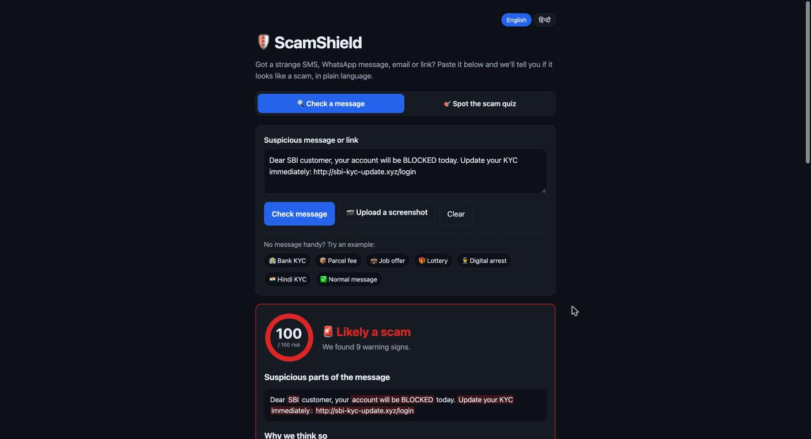
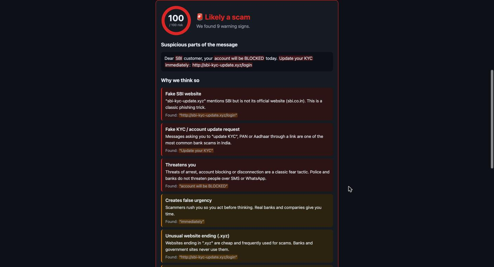
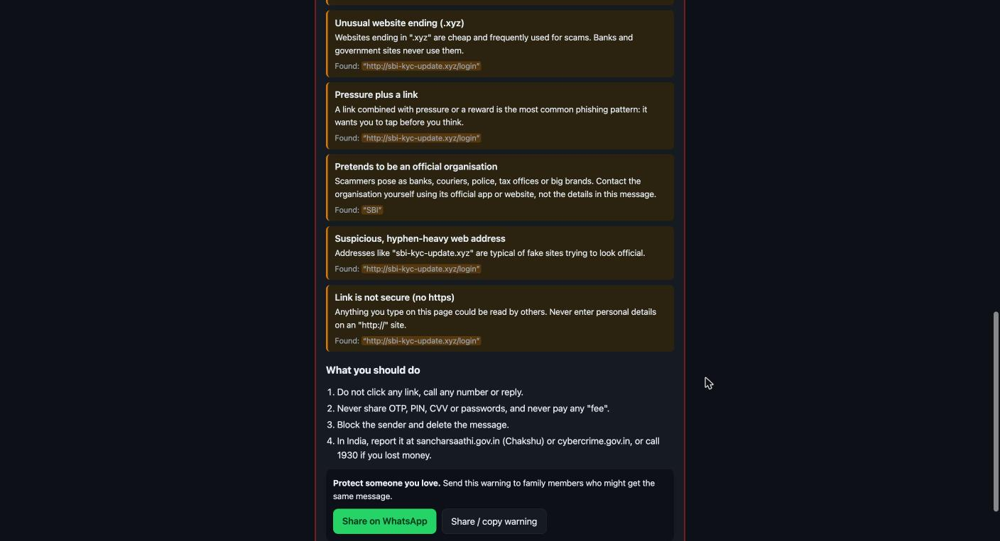
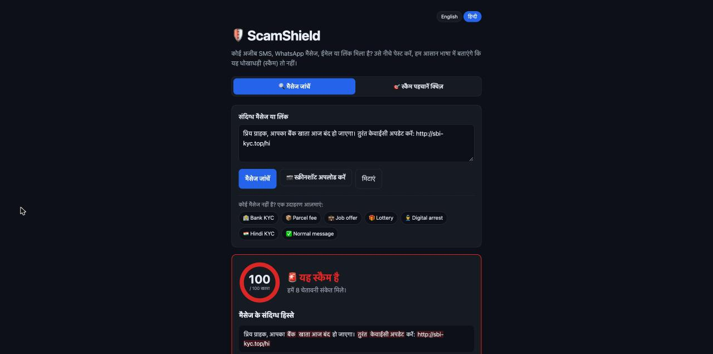
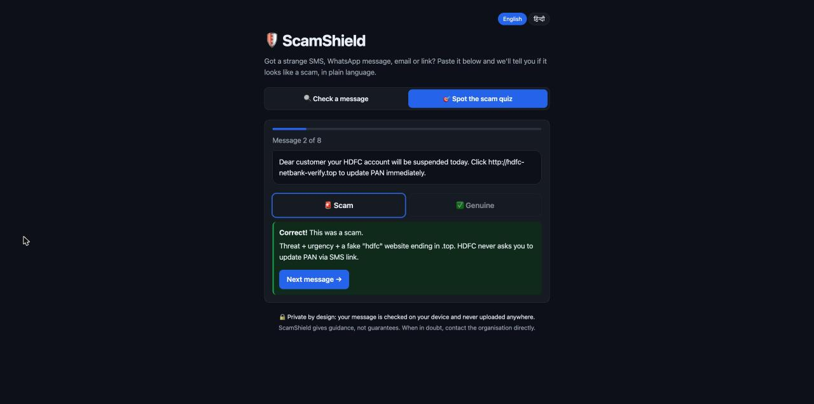

# ScamShield 🛡️

> Paste a suspicious SMS, WhatsApp message, email or link. Find out if it's a scam, explained in plain language.

Built for **Next Byte Hacks V5**.

**🔗 Live demo: https://shineyrbl-byte.github.io/scamshield/**

## Screenshots

| Instant verdict | Plain-language reasons |
| --- | --- |
|  |  |
| **Next steps + warn your family** | **Hindi interface** |
|  |  |



## The problem

Online fraud is exploding. Fake KYC updates, parcel "customs fees", work-from-home job offers and "digital arrest" calls drain people's savings every day. The people hit hardest, elderly parents and first-time internet users, are the least able to tell a fake message from a real one, and often have no one to ask in the moment.

## What it does

- **Instant risk score (0–100)**: *Looks safe*, *Suspicious* or *Likely a scam*.
- **Plain-language reasons**: every warning sign is explained in simple words, not jargon.
- **Highlights the dangerous parts** of the message so users learn to spot them next time.
- **Link inspection**: catches URL shorteners, raw IP links, look-alike characters, risky domain endings and fake brand domains (e.g. `sbi-kyc-update.xyz`).
- **Clear next steps**, including India's cybercrime helpline (1930) and reporting portals.
- **Warn your family**: share a ready-made warning on WhatsApp in one tap.
- **One-tap examples** of the most common scams for learning and demos.
- **Screenshot upload**: can't copy text from WhatsApp? Upload a screenshot and the text is read on your device (OCR, English + Hindi).
- **English and हिन्दी**: detects scams written in Hindi, Hinglish and English, and the whole interface can switch to Hindi.
- **Spot the Scam quiz**: 8 real-world messages (scams and genuine ones) that teach people to recognise the warning signs themselves.
- **100% private**: everything runs in the browser. Messages are never uploaded.

## Scam types detected

Fake KYC / account updates · OTP, PIN & password requests · Threats (arrest, blocking, disconnection) · Prize & lottery bait · Payment / "fee" demands · Fake jobs & easy money · Remote-access apps (AnyDesk, `.apk`) · Moving to WhatsApp/Telegram · Impersonation of banks, couriers, police & brands · Suspicious links

## Getting started

Requires [Node.js](https://nodejs.org/) 20+.

```bash
git clone https://github.com/shineyrbl-byte/scamshield.git
cd scamshield
npm install
npm run dev      # open the printed http://localhost URL
```

Other commands:

```bash
npm test         # run detection engine tests
npm run build    # production build in dist/
npm run lint
```

## How it works

`src/lib/analyzer.js` is a weighted rule engine. Each rule (urgency, threats, credential requests, …) has a set of patterns and a weight; matching several patterns of the same type adds confidence. Links are extracted and checked separately. Weights add up to a capped 0–100 score:

| Score | Verdict |
| --- | --- |
| 0–24 | ✅ Looks safe |
| 25–59 | ⚠️ Suspicious |
| 60–100 | 🚨 Likely a scam |

A brand name on its own (e.g. "HDFC") never raises the score; it only counts alongside another warning sign, which keeps genuine bank alerts from being flagged.

## Tech stack

React 19 · Vite · Tesseract.js (on-device OCR) · plain CSS (dark mode, mobile-first, large type) · Node's built-in test runner

## Project structure

```
src/
  lib/analyzer.js        detection engine
  lib/examples.js        sample scam messages
  lib/share.js           family warning text
  lib/i18n.js            English / Hindi text
  lib/quiz.js            quiz questions
  components/            ResultCard, Highlighted, Quiz, ScreenshotUpload
  App.jsx
tests/analyzer.test.js
```

## Future plans

- More regional languages (Tamil, Bengali, Marathi, Telugu)
- Browser extension and WhatsApp bot
- Community-reported scam number/link database

## Disclaimer

ScamShield gives guidance, not guarantees. When in doubt, contact the organisation directly using its official app or website.
